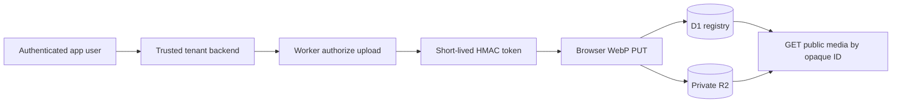

<!-- appfactory:hero:start -->
<div align="center">

# Trigenys Storage

### Private objects. Scoped uploads. Public media by intent.

**A tenant-aware Cloudflare Worker for signed WebP uploads, private R2 objects and opaque public media links, built to serve multiple Trigenys applications.**

[](#capability-maturity-and-constraints)
[](#signed-media-lifecycle)
[](#signed-media-lifecycle)
[](#capability-maturity-and-constraints)

[**Why**](#why-trigenys-storage) · [**Lifecycle**](#signed-media-lifecycle) · [**Limits**](#capability-maturity-and-constraints) · [**Architecture**](#architecture-target) · [**Worker**](backend/README.md) · [**Scaffold**](#current-scaffold)

</div>

---
<!-- appfactory:hero:end -->

## Why Trigenys Storage

A merchant image should not require making an entire bucket public. Storage separates authorized **write intent**, opaque media identity, and deliberately public read access. It is intended as shared storage infrastructure, not another copy of a product's own authentication system.

## Signed media lifecycle



The Worker implements `POST /v1/uploads/authorize`, a signed `PUT /v1/uploads/{tenant}/{id}` and **public-only** `GET /v1/media/{tenant}/{id}`. Trusted applications must independently authorize end users before requesting a tenant upload intent; only metadata explicitly marked public can be read. See the [Worker v1 contract](backend/README.md).

## Capability maturity and constraints

**Prototype implementation:** Worker code and test suites exist, whereas remote provisioning, secret configuration and Xeption production migration require separate deployment evidence. The original Node server is only the AppFactory bootstrap.

**Important limitation:** Immutable public caching is unsuitable for assets that must later be revoked. Signed private reads, full quota enforcement, deletion and migration of historical Cloudinary media are future work. [Backend contract](backend/README.md) · [Worker source](backend/src/worker.ts).

Reusable multi-tenant media storage for Trigenys applications. **Xeption is the first intended tenant; the service must be reusable by future apps without forks.**

## Architecture target

- **Worker:** `trigenys-storage-api` for upload validation and public media delivery.
- **R2:** private `trigenys-storage-media` bucket; server-generated `tenants/{tenant}/{folder}/{uuid}.webp` keys.
- **D1:** tenant-owned metadata and opaque media IDs; no client-controlled object key.
- **Upload:** Xeption Supabase Edge Function signs a brief upload intent; browser converts eligible images to WebP and uploads directly; Worker validates signature, replay, content and size.
- **Read:** versioned public `GET /v1/media/{tenant}/{id}` for media explicitly marked public, with appropriate caching; R2 remains private.
- **Compatibility:** keep existing Cloudinary URLs working during adoption. Migrate historical assets separately with tested fallback/rollback.

These are design targets, not proof of provisioning. See [RAIDER adoption](docs/engineering/raider-adoption.md).

## Project management & quality

- **AppFactory Project Automation:** [delivery runbook](docs/engineering/project-automation.md); canonical config at `.github/project-config.json`; synchronization is triggered by Issue/PR events.
- **Board:** Trigenys Storage Development, phases Foundation → API Contract → Integrations → Hardening → Production.
- **RAIDER upstream:** [EagleFox31/project-registry](https://github.com/EagleFox31/project-registry/blob/main/RAIDER.md). Apply Reusable, Agnostic, Idempotent, Durable/Non-regressive, Engineering-grade, Retroactive and its failure-memory/change-scoped-CI rules.
- **Engineering agent contract:** [AGENTS.md](AGENTS.md); [lessons learned](docs/engineering/lessons-learned.md).
- **Roadmap:** [GitHub Issues](https://github.com/Trigenys/trigenys-storage/issues).

## Current scaffold

- Node.js 24, TypeScript, native HTTP server, Node test runner.
- `GET /health` is the only endpoint in the generated **root** Node scaffold; the separate Worker runtime implements the media APIs described in `backend/README.md`.
- AppFactory Project Automation and reusable release workflow are preconfigured; no `PROJECT_TOKEN` repo secret is required.
- The generic root preset does not provision or verify the separate Worker, R2, D1 and runtime secrets; consult the Worker contract and deployment evidence before asserting live availability.

```bash
npm install
npm run dev
npm run check
npm run build
node dist/src/index.js
```

Do not confuse the generated Node server with a production Cloudflare Worker. Changes to resource ownership, migrations, tenant security and the production cutover must follow review + the RAIDER proof-of-done checklist.
